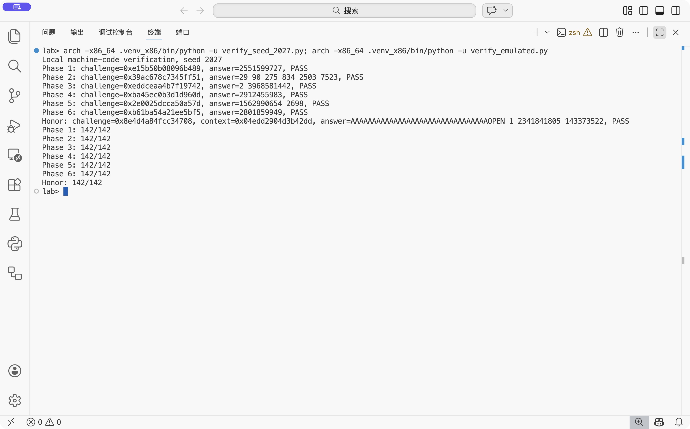

# Lab 2：BombLab 实验报告

本报告不含姓名、学号等个人信息。分析对象为当前个人 `bomb`；计算关系对应 `defuser.c` 中的实现。

## 一、实验目标与分析方法

实验要求在 `defuser.c` 中实现六个普通关卡及 Honor 的求解函数。每个普通关卡接收 64 位 `challenge`，输出由它决定的无符号十进制整数；Honor 还接收由前六关答案计算出的 `context`。隐藏测试会更换种子，因此实现必须恢复计算关系，不能保存某个种子的固定答案。

分析以个人 `bomb` 的符号和 x86-64 反汇编为依据：先定位 `phase_01` 至 `phase_06`、`secret_gate` 和被它们调用的辅助函数，再沿参数寄存器、条件跳转、函数指针表及内存访问追踪数据流。以下 `C` 表示 64 位 `challenge`，`L=(uint32_t)C`，`H=(uint32_t)(C>>32)`。所有标成 `u32` 的加法、乘法和异或都以 32 位无符号数计算，溢出后保留低 32 位；`>>` 为无符号右移。

## 二、逐关分析

### Phase 1：函数参数与返回值

`phase_01` 先要求输入恰好一个 `uint32_t`，随后调用 `p1_compute` 并比较输入和 `eax`。`p1_compute` 将 `C` 的不同位段传给三个小函数。关键指令如下：

```asm
p1_step1: xor esi, 0xc569
          lea eax, [rsi + 2*rdi]
p1_step0: lea eax, [rdi + 8*rsi]
          xor eax, 0x60b1
p1_step2: lea eax, [rsi + 0x2178]
          xor eax, edi
```

按 System V AMD64 调用约定，前两个整型参数在 `rdi`、`rsi`，返回值在 `eax`。结合 `p1_compute` 的调用顺序，设 `M=(uint32_t)(C>>16)`，得到：

```text
s1 = (M xor 0xc569) + 2H
s0 = (L + 8H) xor 0x60b1
answer = (s1 + 0x2178) xor s0
```

因此 `solve_phase_1` 输出一个无符号整数。非公开种子 `2027` 的答案为 `2551599727`。

### Phase 2：数组与递推

`phase_02` 要求六个整数。初值由 `shr rax, 0x6; and eax, 0x1f` 确定。循环中，`rdx` 是当前下标 `i`，关键指令为：

```asm
lea ecx, [rdx + 0xf]       ; i + 15
shr rax, cl
and eax, 0xf
lea ecx, [rdx + 0x5]       ; i + 5
xor eax, ecx
lea ecx, [rsi + 2*rsi]     ; 3 * 前一项
add eax, ecx
cmp esi, eax
```

故输出数组满足：

```text
a[0] = (C >> 6) & 31
a[i] = 3a[i-1] + ( ((C >> (i+15)) & 15) xor (i+5) ),  i=1..5
```

比较指令使用计算结果核对当前输入；不能只求初值。种子 `2027` 的六项为 `29 90 275 834 2503 7523`。

### Phase 3：`switch` 与跳转表

`phase_03` 要求两个整数。第一项在 `and edi, 0x7` 后与输入比较，故 `index=L&7`。第二项的计算参数是 `x=(uint32_t)(C>>3) xor H`。`p3_dispatch` 的 `jmp qword ptr [8*rax+0x405820]` 用 `index` 选取目标；逐项读取跳转表并检查各目标函数后，得到：

| `index` | 目标函数 | 第二项 `f(index,x)` |
| ---: | --- | --- |
| 0 | `p3_case_7` | `5x + 0x358b3` |
| 1 | `p3_case_4` | `(x xor 0xff97) + (x >> 1)` |
| 2 | `p3_case_6` | `4x xor 0xde72` |
| 3 | `p3_case_0` | `(x xor 0x475b) + (x >> 1)` |
| 4 | `p3_case_2` | `5x + 0xb89` |
| 5 | `p3_case_3` | `4x xor 0x4122` |
| 6 | `p3_case_1` | `5x + 0x1997e` |
| 7 | `p3_case_5` | `3x + 0x506f` |

表项次序不同于函数名后缀，不能把 `index=2` 直接对应到 `p3_case_2`。种子 `2027` 有 `index=2`、`x=0x7b22d84c`，因此走 `p3_case_6`，输出 `2 3968581442`。

### Phase 4：递归及返回阶段的计算

`phase_04` 令 `target=L&127`，`salt=(uint32_t)(C>>7) xor H`，调用 `p4_walk(target,0,127,salt)`。函数先计算中点 `mid=low+((high-low)>>1)`，再用 `cmp`、`jb` 决定搜索左右半区。关键返回指令是 `lea eax,[rax+2*rax]`（子结果乘 3），随后分别异或 `0x0a` 或 `0x13`；相等分支以 `lea eax,[rdi+3]; xor eax,ecx` 结束。

```text
F(target,low,high,salt):
  mid = low + ((high-low)>>1)
  target == mid:  return (mid+3) xor salt
  target <  mid:  return (3*F(target,low,mid-1,salt) xor (mid+salt)) xor 0x0a
  target >  mid:  return (3*F(target,mid+1,high,salt) xor (mid+salt)) xor 0x13
```

递归路径上的每一级都在返回时继续修改结果。种子 `2027` 的 `target=13`，路径依次经过中点 `63→31→15→7→11→13`，最终输出 `2912455983`。

### Phase 5：结构体与链表

`phase_05` 要求两个整数并调用 `p5_traverse`。`mov rdx,[8*rax+0x405b60]` 以 `C&7` 选择链表头；`[rdx]`、`[rdx+4]`、`[rdx+8]` 分别被作为 32 位 `tag`、32 位 `value`、64 位 `next` 使用，因此节点长度为 16 字节。`(C>>3)&3` 决定继续走多少条 `next` 链接。

设 `start=C&7`、`steps=(C>>3)&3`，初始化及迭代关系是：

```text
fold = (uint32_t)(C>>6) xor H
fold = (fold xor head.tag xor 0x298a) + head.value
每沿 next 到一个新节点：fold = (fold xor node.tag) + node.value
输出：fold 和最终节点的 value
```

从数据段还原的同一条链上的 `(tag,value)` 依次为：

```text
0:(0x017e,1626)  1:(0x1d3e, 859)  2:(0xa311, 638)  3:(0x9f62,1091)
4:(0x39e3,2144)  5:(0x0dd6,2853)  6:(0x97da,1918)  7:(0xcc32,  77)
8:(0x600d,2698)  9:(0xb4bb,1346) 10:(0xdbbc, 283) 11:(0x5ed2,2397)
```

前八个节点分别可作为头节点，最多再走三步，因此后续节点也需要记录。种子 `2027` 从节点 5 出发、再走 3 步，到节点 8，输出 `1562990654 2698`。

### Phase 6：函数指针表与间接调用

`p6_dispatch` 先形成 `x=(uint32_t)(C>>6) xor H`，用 `C&7` 及 `(C>>3)&7` 两次索引 `0x405e00` 处的函数指针表。关键汇编如下：

```asm
call qword ptr [8*rax + 0x405e00]
xor  eax, 0xde0d
call qword ptr [rbx + 0x405e00]
add  eax, 0x9199
```

`rbx` 在第二次调用前保留了第二索引乘 8。表的 0 至 7 项依次对应 `op0, op1, op5, op0, op4, op2, op2, op3`。各函数关系为：

```text
op0(x)=ROR32(x,7)                 op1(x)=(4x+0xd840) xor 5x
op2(x)=ROL32(x,3) xor 0x34c3     op3(x)=(x xor 0xcfb2)+8x
op4(x)=(x xor (x>>7))+0x2788    op5(x)=(x+0x1355) xor (x>>1)
```

因此最终值为 `op[second](op[first](x) xor 0xde0d)+0x9199`。种子 `2027` 的两个索引为 5 和 6，均落在 `op2`，输出 `2801859949`。

### Honor：字符串门控与三项数值校验

`secret_gate` 先检查字符串长度。`sub rax,0x24; cmp rax,0x7f; jbe ...` 对应长度在 36 至 163 字节之间。复制后的偏移 32 处与立即数 `0x4e45504f` 比较；按小端序解释为 ASCII `OPEN`。随后把偏移 36 处的后缀传给 `secret_phase`。因此使用 32 个 `A` 字符、`OPEN`、一个空格和三个十进制整数构造输出。

`secret_phase` 中 `valid_u32_fields(...,3)` 要求后缀恰好三个无符号整数。设：

```text
Cmix = (uint32_t)challenge xor (uint32_t)(challenge>>32)
Tmix = (uint32_t)context   xor (uint32_t)(context>>32)
M = Cmix xor Tmix
S(M) = ((M>>1) xor 0x884b) + (M xor 0x472f)
v0 = (uint32_t)context & 3
v1 = S(M) xor (v0*0x472f) xor (uint32_t)(context>>16)
v2 = v1 xor (Tmix + v0 + 0x884b + (Cmix>>1))
```

上述关系来自 `secret_mix` 的 `shr/xor/add` 和 `secret_phase` 对三个输入值的逐项比较。`context` 不能用固定常数代替：驱动的 `transcript_context` 会依次混合前六关每个答案中的整数。种子 `2027` 的 `context=0x04edd2904d3b42dd`，Honor 输出为：

```text
AAAAAAAAAAAAAAAAAAAAAAAAAAAAAAAAOPEN 1 2341841805 143373522
```

## 三、本地验证记录

`defuser.c` 已通过项目 `make` 编译（项目使用 `-Werror`）。本机为 Apple Silicon macOS，而个人 `bomb` 是 x86-64 Linux ELF；本机不能直接完成 README 所示的 Linux 管道运行。因此使用 Rosetta 下的 x86-64 Unicorn 执行个人 `bomb` 的真实关卡机器码，并对 `valid_u32_fields`、`sscanf`、`strlen` 提供解析钩子。比较标准是关卡函数返回 `1`。这验证了关卡核心计算与输入格式，但不等于官方 `public_test.py` 或完整 Linux 进程运行成功。

在 10 个公开种子和另外 132 次种子输入构成的 142 次测试中，每一关及 Honor 的结果都是 `142/142`。这些输入集合存在重复种子，因此这里统计的是测试次数。另选不在 `tests/public.json` 中的 `2027` 作为逐关记录：

| 关卡 | `challenge` | 输出 | 机器码检验 |
| --- | --- | --- | --- |
| Phase 1 | `0xe15b50b08096b489` | `2551599727` | PASS |
| Phase 2 | `0x39ac678c7345ff51` | `29 90 275 834 2503 7523` | PASS |
| Phase 3 | `0xeddceaa4b7f19742` | `2 3968581442` | PASS |
| Phase 4 | `0xba45ec0b3d1d960d` | `2912455983` | PASS |
| Phase 5 | `0x2e0025dcca50a57d` | `1562990654 2698` | PASS |
| Phase 6 | `0xb61ba54a21ee5bf5` | `2801859949` | PASS |
| Honor | `0x8e4d4a84fcc34708` | 见上节；`context=0x04edd2904d3b42dd` | PASS |

下图是 VS Code 集成终端中的实际本地运行画面，包含非公开种子 `2027` 的七项结果和 142 次测试汇总。截图记录的是机器码检验，不代表官方 `public_test.py` 已在 Linux 环境中运行。



## 四、参考资料与辅助工具

- [课程 BombLab README](https://github.com/ICS-26Fall-FDU/BombLab)：提交格式、评分、测试与报告要求。
- 本项目的 `challenge.c`、`defuser_main.c`、`tests/public.json`：核对挑战值、Honor `context` 的生成方法和公开种子列表。
- 个人 `bomb` 的符号表、反汇编和数据段：推导本报告中的分支、常数、链表与函数表。
- `objdump`：读取关键函数的汇编。C 编译器和 `make`：构建 `defuser.c`。Rosetta 下的 x86-64 Unicorn：对真实关卡机器码进行本地验证。
- OpenAI Codex：辅助反汇编阅读、计算关系整理、代码实现、本地验证脚本和报告文字整理。

